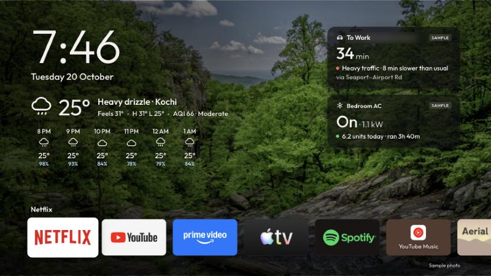

# Clear Home

A calm, photo-first home screen for a TCL Google TV / Android TV. It replaces the busy
stock launcher with your own photos, the time and weather, a few glanceable cards and a
Dock-style app row.

Clear Home was started by [Ajzal](https://github.com/Mohammedajzal).



## What it does

- **Photo background** from a Google Drive folder, cached on the TV. Each photo is checked
  (landscape, ≥1080p, sharp, well exposed) before it's shown. Captions show place / date /
  camera in the idle photo-frame view.
- **Clock and weather** (Open-Meteo, no key): animated icon, feels-like, high/low, air quality.
- **Air conditioner card** from Tapo P110 smart plugs on the local network: on / standby /
  off, live power, units today and this month. An AC icon animates while it's cooling.
- **Traffic map** around home (Mapbox static map with live traffic), refreshed every 10 min.
- **Dock-style app row** with macOS-like magnification, real app banners, Settings at the end.
- **Idle photo frame**: after 12 s without input, the cards and app row fade away.
- **Remote button remap**: the remote's TCL button opens Clear Home (accessibility service).
- Settings for layout (Dashboard / Shelf / List / Dock / Grid), background, font, clock,
  hourly forecast, and choosing/ordering apps.

The UI is plain HTML/CSS/JS in `app/assets/`, hosted in a WebView by a small Android app in
`app/src/`. It builds with the Android SDK command-line tools only (no Gradle).

## Build and install

Needs Android Studio installed (for its bundled Java and the SDK), and USB/network debugging
enabled on the TV (Settings → System → About → press *Android TV OS build* 7 times, then
Settings → System → Developer options).

```bash
./build.sh                   # → build/ClearHome.apk
./install.sh 192.168.1.50    # your TV's IP; remembered in .tv afterwards
```

## Preview in a browser

```bash
python3 -m http.server 8765
```

Open http://localhost:8765/app/assets/index.html. Arrows move, Enter is OK, Esc is Back,
M opens Settings. `app/assets/mock.js` supplies sample apps and data.

## Connecting services

Each service reads a file in `secrets/` (git-ignored; copy the matching `*.example.json`).
A script sends it to the TV over adb, where it's moved into private storage and the copy deleted.

| Card | Setup | Send to TV |
| --- | --- | --- |
| Photos (Google Drive) | Google Cloud project with the Drive API and a *Desktop app* OAuth client → `secrets/google-desktop.json` | `./google-signin.sh` (browser sign-in, then pick the folder) |
| Photo dates/places from Google Photos | A Google Photos Takeout export | `./takeout-sidecars.sh ~/Downloads/takeout-*.zip` |
| Air conditioners | Tapo app → Me → Third-Party Services → *Third-Party Compatibility* on → `secrets/tapo.json` (one login per plug) | `./tapo-signin.sh` |
| Traffic map | Mapbox public token + home coordinates → `secrets/commute.json` | `./commute-setup.sh` |

The TCL button remap needs two switches on the TV: allow Clear Home under TCL's
**Auto-start** (Guard app), then Settings → System → Accessibility → **Clear Home remote button**.

## Use it as the Home button

```bash
./home.sh status
./home.sh use       # saves the original setting to .home-backup first
./home.sh restore   # puts the stock launcher back
```

On Google TV, `use` disables the stock launcher package for the current user
(`pm disable-user`); nothing is uninstalled and no root is needed.

## Layout

| Path | What |
| --- | --- |
| `app/assets/` | The home screen: `index.html`, `app.js` (navigation, settings, screens), `dashboard.js` (photo dashboard), `app.css`, `mock.js` (browser preview data) |
| `app/src/dev/local/clearhome/` | Android side: `MainActivity` (WebView + bridge), `GoogleDrive`, `Tapo`, `Commute`, `RemoteButton`, `Devices`, `Http` |
| `tools/` | Mac-side helpers behind the `*.sh` scripts |
| `design/` | Screenshots and preview assets |

Sample background photos are from [Unsplash](https://unsplash.com) (via picsum.photos);
the font is [Outfit](https://github.com/Outfitio/Outfit-Fonts) (OFL); QR codes use
[qrcode-generator](https://github.com/kazuhikoarase/qrcode-generator) (MIT).
